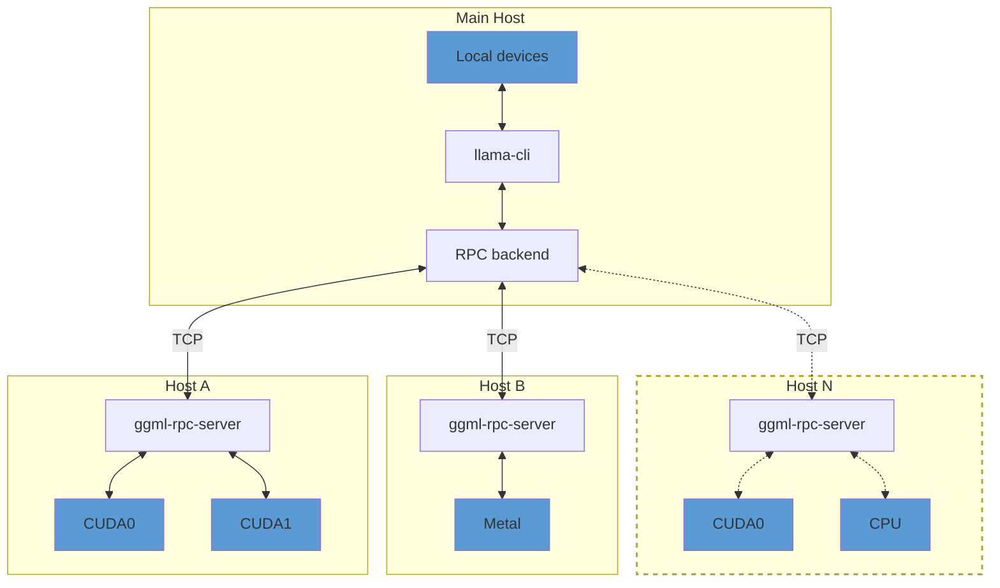

## Overview

> [!IMPORTANT]
> This example and the RPC backend are currently in a proof-of-concept development stage. As such, the functionality is fragile and
> insecure. **Never run the RPC server on an open network or in a sensitive environment!**

The `ggml-rpc-server` allows exposing `ggml` devices on a remote host.
The RPC backend communicates with one or several instances of `ggml-rpc-server` and offloads computations to them.
This can be used for distributed LLM inference with `llama.cpp` in the following way:



By default, `ggml-rpc-server` exposes all available accelerator devices on the host.
If there are no accelerators, it exposes a single `CPU` device.

## Usage

### Remote hosts

On each remote host, build the backends for each accelerator by adding `-DGGML_RPC=ON` to the build options.
For example, to build the `ggml-rpc-server` with support for CUDA accelerators:

```bash
mkdir build-rpc-cuda
cd build-rpc-cuda
cmake .. -DGGML_CUDA=ON -DGGML_RPC=ON
cmake --build . --config Release
```

When started, the `ggml-rpc-server` will detect and expose all available `CUDA` devices:

```bash
$ bin/ggml-rpc-server
ggml_cuda_init: GGML_CUDA_FORCE_MMQ:    no
ggml_cuda_init: GGML_CUDA_FORCE_CUBLAS: no
ggml_cuda_init: found 1 CUDA devices:
  Device 0: NVIDIA GeForce RTX 5090, compute capability 12.0, VMM: yes
Starting RPC server v3.0.0
  endpoint       : 127.0.0.1:50052
  local cache    : n/a
Devices:
  CUDA0: NVIDIA GeForce RTX 5090 (32109 MiB, 31588 MiB free)
```

You can control the set of exposed CUDA devices with the `CUDA_VISIBLE_DEVICES` environment variable or the `--device` command line option. The following two commands have the same effect:
```bash
$ CUDA_VISIBLE_DEVICES=0 bin/ggml-rpc-server -p 50052
$ bin/ggml-rpc-server --device CUDA0 -p 50052
```

### Main host

On the main host build `llama.cpp` with the backends for the local devices and add `-DGGML_RPC=ON` to the build options.
Finally, when running `llama-cli` or `llama-server`, use the `--rpc` option to specify the host and port of each `ggml-rpc-server`:

```bash
$ llama-cli -hf ggml-org/gemma-3-1b-it-GGUF -ngl 99 --rpc 192.168.88.10:50052,192.168.88.11:50052
```

By default, llama.cpp distributes model weights and the KV cache across all available devices -- both local and remote -- in proportion to each device's available memory.
You can override this behavior with the `--tensor-split` option and set custom proportions when splitting tensor data across devices.

### Local cache

The RPC server can use a local cache to store large tensors and avoid transferring them over the network.
This can speed up model loading significantly, especially when using large models.
To enable the cache, use the `-c` option:

```bash
$ bin/ggml-rpc-server -c
```

By default, the cache is stored in the `$HOME/.cache/llama.cpp/rpc` directory and can be controlled via the `LLAMA_CACHE` environment variable.

### RDMA transport

The RPC backend can use RDMA instead of TCP for lower latency and higher throughput. The transport is negotiated during the initial handshake -- no changes to command-line usage are required, and the connection falls back to TCP unless both peers can use RDMA.

Two providers are supported, each enabled by default when its library is found at build time:

- **Linux**: RoCEv2-capable NICs (e.g. Mellanox ConnectX), via `libibverbs`.
- **macOS**: RDMA over Thunderbolt on Apple silicon Macs with Thunderbolt 5, via `librdma`. Requires macOS 26.2 or later, with RDMA enabled once from macOS Recovery via `rdma_ctl enable`. See [TN3205](https://developer.apple.com/documentation/technotes/tn3205-low-latency-communication-with-rdma-over-thunderbolt).

RDMA is point-to-point, so each side uses the local device whose GID matches the address the connection was made on. Connect over the RDMA-capable link -- with Thunderbolt, use the peer's Thunderbolt address in `--rpc`; a connection made over another interface stays on TCP.

To force plain TCP without rebuilding, set `GGML_RPC_NO_RDMA` on either peer:
```bash
$ GGML_RPC_NO_RDMA=1 bin/ggml-rpc-server
```

### Troubleshooting

The `GGML_RPC_DEBUG` environment variable controls the verbosity of the logs emitted by the RPC backend.
It can be set on the server, on the client (e.g. `llama-cli`), or both. Larger values produce more detailed output:

- unset / `0` - disabled (only warnings and errors are printed)
- `1` - high-level events: connections, handshake, buffer allocations, graph computes, cache evictions
- `2` - per-command trace: every RPC message sent/received, tensor transfers, cache hits/misses
- `3` - fine detail: per-command timings, graph node dumps, transport byte counts

Non-numeric values are treated as `1`.

```bash
$ GGML_RPC_DEBUG=1 bin/ggml-rpc-server
```

> [!NOTE]
> The debug levels are emitted as `ggml` debug records, which `llama.cpp` applications drop unless the
> global verbosity threshold is raised. On the client, pass `-lv 5` together with `GGML_RPC_DEBUG`:

```bash
$ GGML_RPC_DEBUG=2 bin/llama-cli -hf ggml-org/gemma-3-1b-it-GGUF -ngl 99 --rpc 192.168.88.10:50052 -lv 5
```

## Windows with NVIDIA CUDA (creature-llama.cpp scripts)

This fork adds PowerShell scripts that build and run the setup above on Windows with NVIDIA GPUs, plus a monitoring and model-management layer for the Web UI. Run them from `tools/rpc` in a PowerShell window.

Each machine needs Git, Visual Studio with the "Desktop development with C++" workload and the CMake tools, the CUDA toolkit, and the NVIDIA driver.

| File | Runs on | What it does |
|---|---|---|
| `install-rpc.ps1 -Role Host` | each host | builds `ggml-rpc-server`, opens the firewall for TCP 50052 and 50053 (local subnet only, needs Administrator) |
| `install-rpc.ps1 -Role Master` | master | builds `llama-server` and `llama-cli` with RPC; `-BuildUi` builds the Web UI from source so it has the RPC and Models tabs; `-Hosts` checks that the hosts are reachable |
| `start-rpc-server.ps1` | each host | starts the RPC server and its stats agent (`-Cache`, `-Port`, `-Device`, `-NoAgent`) |
| `stats-agent.ps1` | each host and the master | serves `GET /stats` on port 50053: GPU load, VRAM, temperature, power, CPU, RAM, network |
| `start-master.ps1` | master | starts `llama-server` in router mode over a models folder |
| `add-model.ps1` | master | copies or downloads a `.gguf` into the models folder and rescans |
| `models.ini` | master | shared and per-model settings (context size, tensor split, aliases, draft model) |

### Hosts

```powershell
git clone https://github.com/creativetech2/creature-llama.cpp
cd creature-llama.cpp\tools\rpc
.\install-rpc.ps1 -Role Host       # Administrator PowerShell, builds and opens the ports
.\start-rpc-server.ps1 -Cache      # run this whenever the host should serve
```

The install script prints the host's IP address. Use it in the master's `--rpc` list.

### Master

```powershell
.\install-rpc.ps1 -Role Master -BuildUi -Hosts 192.168.1.15:50052,192.168.1.44:50052
.\start-master.ps1 -Hosts 192.168.1.15:50052,192.168.1.44:50052 -ApiKey secret
```

`start-master.ps1` serves the Web UI and the API on `http://127.0.0.1:9931` (change it with `-Port`). Put models in `%USERPROFILE%\llama-models`, or pass `-ModelsDir`. A file `X.gguf` appears as the model `X`. Models with several files (sharded or multimodal) go in a subfolder of their own.

```powershell
.\add-model.ps1 -Source D:\downloads\Qwen3-8B-Q4_K_M.gguf
.\add-model.ps1 -Source https://huggingface.co/<user>/<repo>/blob/main/<file>.gguf
```

Both copy the file and tell a running router to rescan. Models load on the first request that names them, or from the Models tab.

### Web UI tabs

With the UI built from source (`-BuildUi`), the sidebar has two extra entries:

- **RPC**: one card per machine (the master and each `--rpc` host) with GPU load, VRAM, temperature and power per GPU, a short history graph, CPU, RAM and network use, and whether the host's RPC server is idle or serving a client. A "Now running" panel lists the loaded models with busy slots, prompt and generation speed (needs `--metrics`, which `start-master.ps1` sets) and queued requests.
- **Models**: the model manager as a page. Load and unload models and watch their status. "Rescan folder" re-reads the models folder and `models.ini` after you add or edit files.

The RPC tab reads `GET /rpc/stats`, a `llama-server` endpoint that polls the stats agent of the master and of every `--rpc` host (port 50053, or `LLAMA_RPC_STATS_PORT`) in parallel. A host whose agent does not answer shows as "Agent offline" and the rest still update. The endpoint respects `--api-key`. It does not query the RPC devices themselves, because a down host would abort `llama-server`.

### Ports

| Port | Where | Purpose |
|---|---|---|
| 50052 | each host | RPC server (`ggml-rpc-server`) |
| 50053 | each host and the master | stats agent, read-only JSON |
| 9931 | master | `llama-server`: API, Web UI, `/rpc/stats` |

Both host ports are opened for the local subnet only. Neither the RPC server nor the stats agent has authentication, so keep them on a trusted network.

### Limits and notes

- **One model at a time.** The RPC server serves one client at a time, and a loaded model holds its connection to every host. A second model on the same hosts would hang, so `start-master.ps1` uses `--models-max 1`: loading a model unloads the current one first (up to 10 seconds). Restart the router only while the hosts are idle, otherwise it waits for a busy host.
- **Hosts must be up before the router starts.** `llama-server` aborts at startup if an `--rpc` host is down. `start-master.ps1` checks each host first and stops with a clear message.
- **Visual Studio 2026.** CUDA 12.8, 13.0 and 13.1 reject its compiler (MSVC 14.50). The install script uses an older MSVC toolset when one is installed. Otherwise it builds with `-allow-unsupported-compiler`, which compiled the full backend fine here. Installing "MSVC v143 - VS 2022 C++ x64/x86 build tools" avoids the warning.
- **CUDA version.** The script ignores `CUDA_PATH` and picks an installed toolkit that fits the GPU: compute capability 10 and newer (RTX 50 series) needs CUDA 12.8 or newer, and capability below 7.5 needs a CUDA 12.x toolkit.
- **No HTTPS in the build** unless OpenSSL is installed, so `-hf` downloads do not work. Use `add-model.ps1`, which downloads with `curl.exe`.
- **`curl` and the UI.** The Web UI assets are served gzipped, so `curl` needs `--compressed` to fetch `/`. Browsers send the header themselves.
- **Rebuilding the UI.** The first `-BuildUi` build runs `npm ci` and needs internet. A leftover `tools/ui/dist` folder would be embedded instead of a fresh build, so the script stops if it exists.
- **Speed.** The default layer split pools memory, it does not add speed: tokens pass through the GPUs one after another, and the slowest GPU sets the pace. See `docs/multi-gpu.md` for the split modes.

### Using it from Claude Code

`llama-server` serves the Anthropic Messages API (`/v1/messages`), so Claude Code can use the pool. Set the variables in the terminal where you start `claude`, with the model id taken from the Models tab. Not tested in this fork yet.

```powershell
$env:ANTHROPIC_BASE_URL = "http://127.0.0.1:9931"
$env:ANTHROPIC_AUTH_TOKEN = "secret"
$env:ANTHROPIC_MODEL = "<model id>"
claude
```

Claude Code sends a large prompt, so give the model a context of 32k tokens or more (`c` in `models.ini`), and pick a model with good tool calling.

